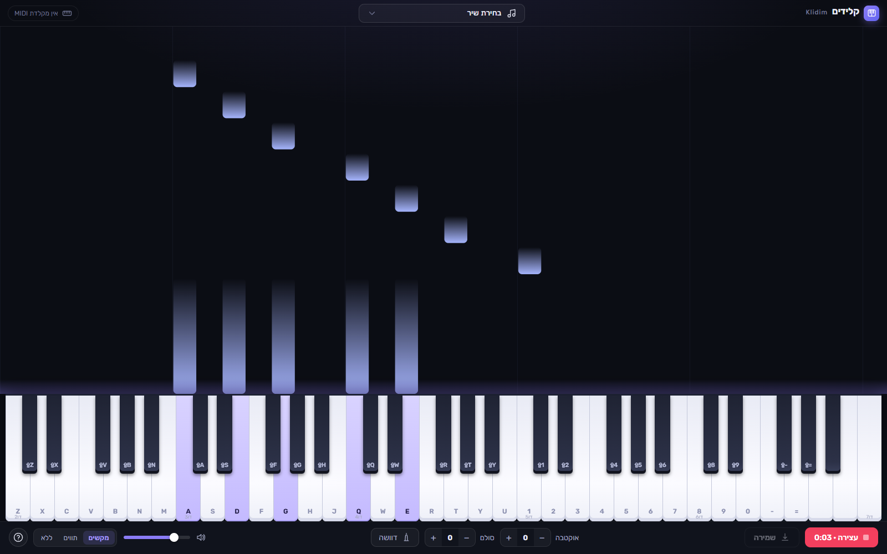
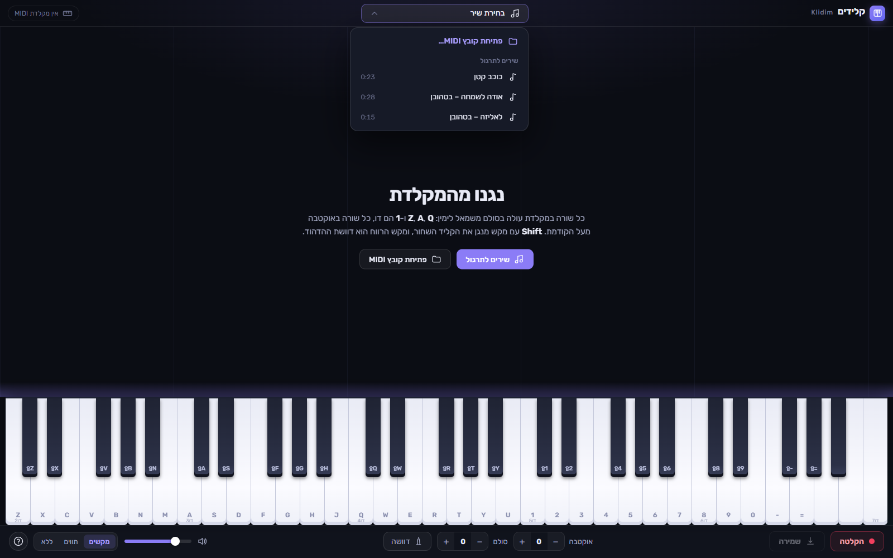
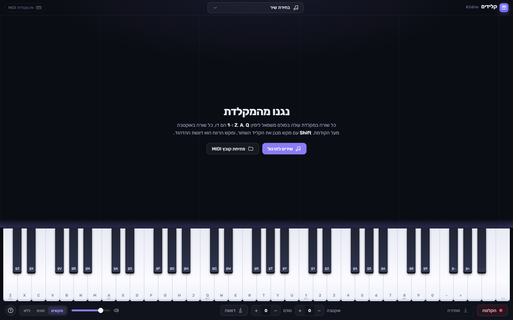

<div dir="rtl">

<p align="center">
  
</p>

<h1 align="center">קלידים · Klidim</h1>

<p align="center">
  <b>פסנתר למחשב, בעברית מלאה ובעיצוב מודרני.</b><br />
  מנגנים מהמקלדת של המחשב, מקליטים, מתרגלים שירים עם תווים נופלים, ומחברים מקלדת MIDI.
</p>

<p align="center">
  <a href="https://github.com/dor2500/klidim/releases/latest"></a>
  
  
  <a href="LICENSE"></a>
</p>

<p align="center">
  <a href="https://github.com/dor2500/klidim/releases/latest/download/Klidim-Setup-0.1.0.exe"><b>⬇️ הורדה להתקנה</b></a>
  &nbsp;·&nbsp;
  <a href="https://github.com/dor2500/klidim/releases/latest/download/Klidim-Portable-0.1.0.exe">גרסה ניידת (בלי התקנה)</a>
</p>


## מה יש בתוכנה

- 🎹 **נגינה מהמקלדת של המחשב** – כל שורה במקלדת היא סולם, בדיוק לפי סדר המקשים. Shift מנגן את הקליד השחור.
- 🎼 **צליל פסנתר אמיתי** – הקלטות של פסנתר כנף (Salamander Grand Piano), עם דוושת הדהוד והד קל.
- 🌧️ **תווים נופלים** – פותחים קובץ MIDI ורואים את התווים יורדים אל הקלידים, בצבע שונה לכל יד.
- 🐢 **תרגול בקצב שלכם** – מהירות 50%, 75%, 100% או 125%, קפיצה לכל מקום בשיר, והשתקה של יד אחת כדי לנגן אותה בעצמכם.
- 🔴 **הקלטה** – מקליטים מה שניגנתם, מנגנים בחזרה ושומרים כקובץ MIDI.
- 🎛️ **מקלדת MIDI** – מתחברת לבד, כולל עוצמת הקשה ודוושה.
- 🖱️ **נגינה בעכבר** – לוחצים על הקלידים או גוררים עליהם (גליסנדו).
- 🎵 **שלושה שירים לתרגול** – כוכב קטן, אודה לשמחה ולאליזה.
- 🌙 **עיצוב כהה ומודרני**, מימין לשמאל, בגופן Rubik.

## צילומי מסך

| נגינה חופשית והקלטה | בחירת שיר |
| --- | --- |
|  |  |

| מסך הפתיחה | עזרה וקיצורי מקלדת |
| --- | --- |
|  |  |

## התקנה

1. מורידים את **[Klidim-Setup-0.1.0.exe](https://github.com/dor2500/klidim/releases/latest/download/Klidim-Setup-0.1.0.exe)** מדף [הגרסאות](https://github.com/dor2500/klidim/releases/latest).
2. מפעילים את הקובץ ובוחרים לאן להתקין.
3. נוצר קיצור דרך בשולחן העבודה ובתפריט התחל בשם **קלידים**.

**בלי התקנה:** אפשר להוריד את [הגרסה הניידת](https://github.com/dor2500/klidim/releases/latest/download/Klidim-Portable-0.1.0.exe) ולהפעיל אותה ישר, גם מדיסק און קי.

> [!NOTE]
> התוכנה לא חתומה דיגיטלית, ולכן ייתכן ש-Windows יציג את המסך "Windows protected your PC". לוחצים על **More info** ואז על **Run anyway**.

**דרישות:** Windows 10 או 11, 64 ביט. לא צריך חיבור לאינטרנט – הצליל כלול בתוכנה.

**הסרה:** הגדרות ← אפליקציות ← Klidim ← הסרה.

## איך מנגנים

כל שורה במקלדת היא סולם שעולה משמאל לימין ומתחילה ב"דו". כל שורה גבוהה באוקטבה מהשורה שמתחתיה:

| שורה במקלדת | מקשים | אוקטבה |
| --- | --- | --- |
| שורת המספרים | `1 2 3 4 5 6 7 8 9 0 - =` | דו5 והלאה |
| שורה עליונה | `Q W E R T Y U I O P [ ]` | דו4 והלאה |
| שורה אמצעית | `A S D F G H J K L ; '` | דו3 והלאה |
| שורה תחתונה | `Z X C V B N M , . /` | דו2 והלאה |

**קלידים שחורים:** מחזיקים **Shift** ולוחצים על המקש של הקליד הלבן שמתחתיו. למשל `Shift+A` הוא דו♯3.
על כל קליד במסך כתוב איזה מקש מנגן אותו, כך שלא צריך לזכור.

> המקשים עובדים לפי המיקום שלהם במקלדת, אז הכול עובד גם כשהמקלדת על עברית.

### קיצורי מקלדת

| מקש | פעולה |
| --- | --- |
| <kbd>רווח</kbd> | דוושת הדהוד (להחזיק) |
| <kbd>←</kbd> <kbd>→</kbd> | הזזת כל המקלדת באוקטבה |
| <kbd>↑</kbd> <kbd>↓</kbd> | העלאה או הורדה בחצי טון (שינוי סולם) |
| <kbd>Esc</kbd> | השתקת כל הצלילים |

## שירים וקובצי MIDI

- **שירים לתרגול:** לוחצים על "בחירת שיר" למעלה.
- **קובץ משלכם:** "פתיחת קובץ MIDI…" בתפריט, או פשוט גוררים קובץ `.mid` לחלון.
- בסרגל השיר: ניגון והשהיה, עצירה, פס התקדמות, מהירות, וכפתור לכל ערוץ.
- **לתרגל יד אחת:** לוחצים על הערוץ שלה (למשל "יד ימין") כדי להשתיק אותו. התווים שלו עדיין נופלים בשקיפות, ואתם מנגנים אותם.

## הקלטה

1. לוחצים על **הקלטה** (למטה מימין) ומנגנים.
2. לוחצים **עצירה**. ההקלטה נפתחת כשיר, ואפשר לנגן אותה עם תווים נופלים.
3. **שמירה** שומרת אותה כקובץ MIDI. ההקלטות מהפעם הזאת מופיעות גם בתפריט השירים תחת "ההקלטות שלי".

## מקלדת MIDI

מחברים את המקלדת ב-USB (לפני הפתיחה או תוך כדי). בפינה העליונה יופיע השם שלה בירוק. עוצמת ההקשה ודוושת ההדהוד של המקלדת עובדות.

## בנייה מקוד המקור

צריך [Node.js](https://nodejs.org) 20 ומעלה.

```bash
git clone https://github.com/dor2500/klidim.git
cd klidim
npm install
npm run dev      # הפעלה במצב פיתוח
npm run dist     # בניית קובץ התקנה וגרסה ניידת לתיקייה dist
```

`npm run web` מריץ רק את הממשק בדפדפן, לבדיקות מהירות.

<details>
<summary>מבנה הפרויקט</summary>

| קובץ | תפקיד |
| --- | --- |
| `src/main/index.ts` | חלון התוכנה, פתיחה ושמירה של קבצים, הרשאת MIDI |
| `src/renderer/src/engine.ts` | מנוע הצליל: פסנתר, דוושה, ניגון שירים והקלטה |
| `src/renderer/src/music.ts` | מיפוי המקלדת, שמות התווים ומידות הקלידים |
| `src/renderer/src/Stage.tsx` | התווים הנופלים והפסנתר על המסך |
| `src/renderer/src/midi.ts` | קריאה וכתיבה של קובצי MIDI ומקלדות MIDI |
| `src/renderer/src/songs.ts` | השירים המובנים |
| `src/renderer/src/App.tsx` | המסך הראשי והכפתורים |

נבנה עם Electron, React, TypeScript ו-[Tone.js](https://tonejs.github.io).
</details>

## קרדיטים

- צליל הפסנתר: [Salamander Grand Piano](https://archive.org/details/SalamanderGrandPianoV3) מאת Alexander Holm, ברישיון CC BY 3.0.
- [Tone.js](https://tonejs.github.io) ו-[@tonejs/midi](https://github.com/Tonejs/Midi) לצליל ולקובצי MIDI.
- הגופן [Rubik](https://fonts.google.com/specimen/Rubik).

## רישיון

קוד המקור ברישיון [MIT](LICENSE). דגימות הפסנתר ברישיון CC BY 3.0 כמפורט למעלה.

</div>
